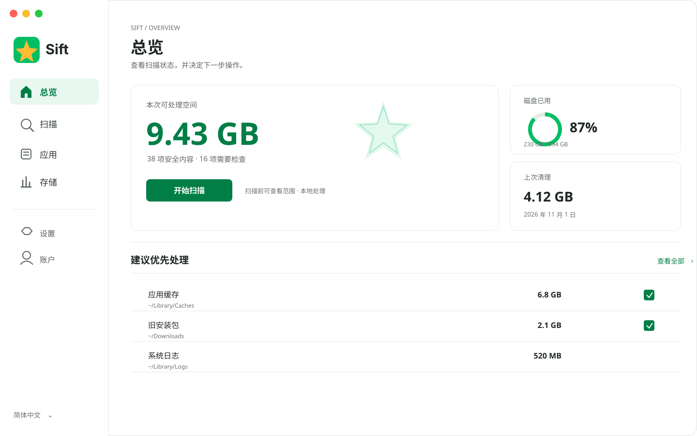
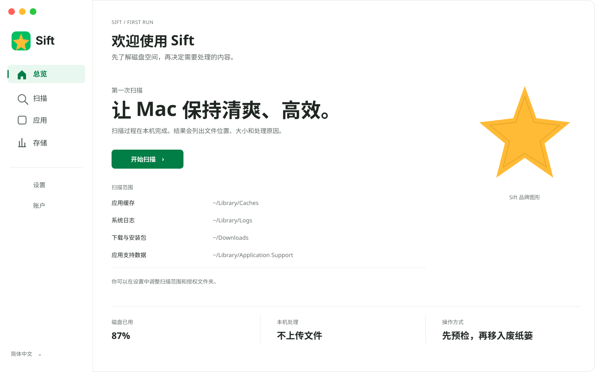
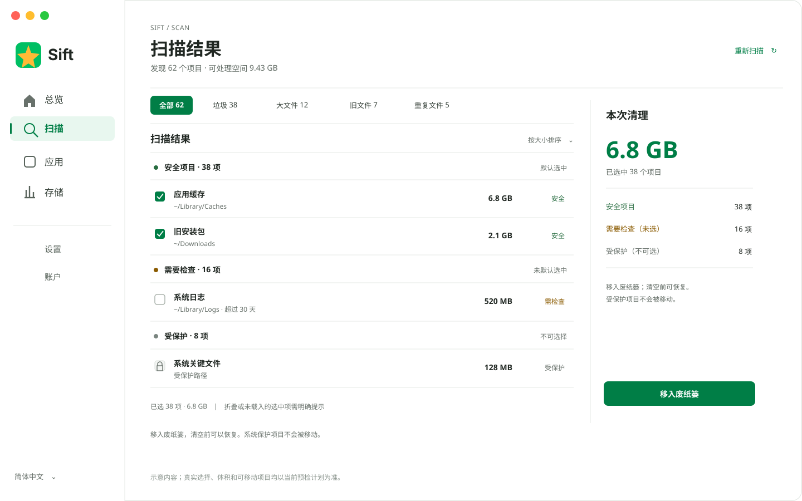

# Sift V2 — UI / Visual Design

> Status: design direction and page specification
> Branch: `design/sift-v2-ui`
> Scope: macOS application UI only; no changes to scanner, file-operation, entitlement, permission, or cleanup-safety behavior.

## Design decision

Sift V2 is a **clean, refined, efficient native macOS utility**. It should feel carefully crafted without looking like a generic SaaS dashboard, an AI-generated template, or a clone of CleanMyMac.

The design is anchored in the existing Sift app icon:

- Brand green: `#00BF63`
- Brand gold: `#FFBA36`
- Main light appearance canvas: pure white `#FFFFFF`

The icon colors are brand identifiers, not colors to spread indiscriminately across every control. Action green is a darker derivative, `#007E46`, so white button text remains readable.

## Read in this order

1. [01 — Visual foundation](01-visual-foundation.md)
2. [02 — Scan and cleanup experience](02-scan-and-cleanup.md)
3. [03 — Remaining page specifications](03-page-specifications.md)
4. [04 — Implementation and acceptance plan](04-implementation-plan.md)
5. [05 — Component-level implementation specification](05-component-specifications.md)
6. [06 — Implementation progress](06-implementation-progress.md)
7. [07 — Follow-up audit and completion gates](07-follow-up-audit.md)

## Visual explorations

The SVGs below are repository-ready vector redraws of the agreed visual direction. They are design studies, not production screenshots or exact interaction prototypes. Their sample text and numbers are illustrative; the written specifications are authoritative.

| Overview concept A | Overview concept B |
|---|---|
|  |  |

## Product principles

1. Efficiency before decoration.
2. Trust before delight.
3. Typography and spacing create hierarchy.
4. Native before novel.
5. Brand without over-branding.
6. Visual refactoring must not weaken cleanup safety.

## Decisions

| Area | Decision |
|---|---|
| Product character | Refined, quiet, professional macOS utility |
| Light canvas | Pure white |
| Brand colors | Icon green and icon gold |
| Existing blue brand treatment | Retire as a brand treatment |
| Purple redesign direction | Do not continue it |
| Glass / blur | Remove from ordinary page content; reserve for native floating surfaces |
| Cards | Reduce substantially; ordinary lists and sections should not be boxed |
| Motion | Functional, brief, and restrained |
| Main workbench | Scan results list is the visual and functional center |

## Not in scope

- Rewriting the Rust scanner or Swift file-operation service.
- Changing scan scope, default selection, protection, or file movement policy.
- Changing entitlement or purchase policy.
- Treating the vector studies as final pixel specifications.

## Change log

- 2026-11-03: V2 direction established from the user-provided app icon and the preference for pure white over cool gray-white.
- 2026-11-03: Scan workflow and all page specifications expanded; visual studies added.
- 2026-11-05: Added a follow-up audit documenting branch divergence, remaining runtime acceptance, and the safety-preserving completion gate.
