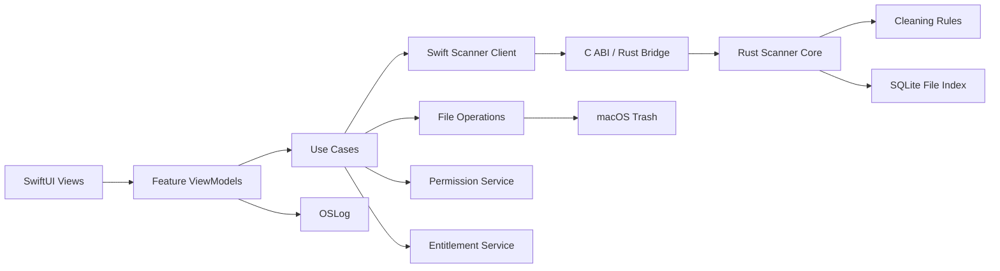
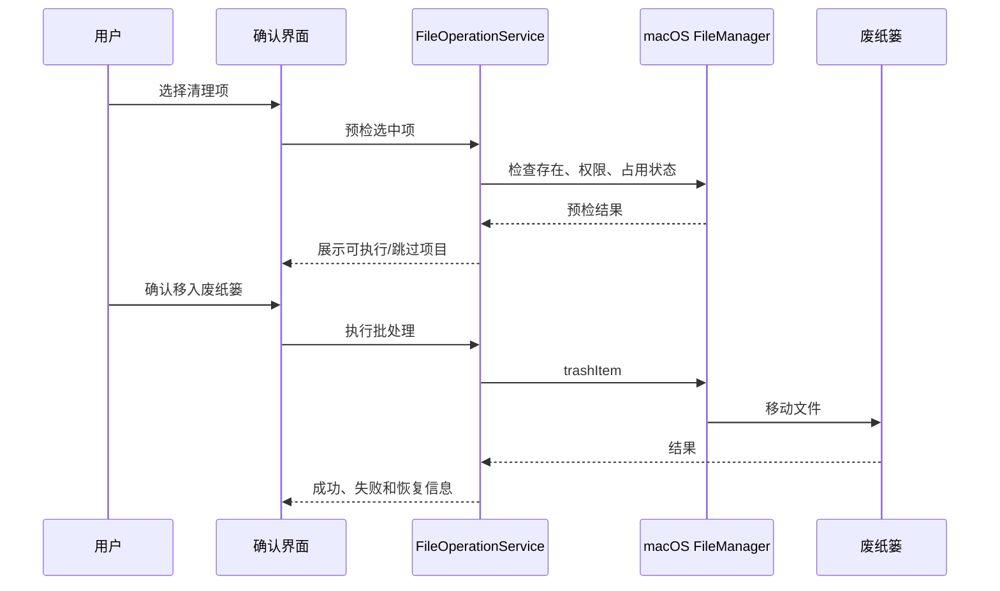

# Sift macOS 清理工具开发文档

版本：v0.1

文档状态：开发基线

产品工作名：Sift

目标平台：macOS

商业模式：$4.99 一次性买断，永久使用

---

## 1. 文档目的

本文档用于统一 Sift 的产品范围、用户体验、技术架构、数据安全策略、开发拆分与验收标准，面向以下角色：

- 产品经理：确认功能边界、用户流程和商业规则
- UI/UX 设计师：实现 macOS 原生风格界面和交互状态
- macOS 开发者：实现扫描、分析、卸载、清理、权限和购买能力
- QA：根据验收标准编写测试用例
- 发布负责人：处理签名、公证、Mac App Store 配置和版本发布

本文档描述的是第一版可发布产品，而不是对 CleanMyMac 的完全复制。Sift 的核心差异是：更少的功能噪声、更透明的清理原因、更强的撤销能力和更低的一次性价格。

## 2. 产品定义

### 2.1 一句话定位

Sift 是一款不依赖账号、不上传用户文件、以“扫描—解释—确认—可恢复清理”为核心流程的轻量 Mac 清理工具。

### 2.2 目标用户

第一版优先服务以下用户：

1. 磁盘空间不足，但不清楚空间被什么占用的普通 Mac 用户。
2. 经常安装和卸载开发工具、设计软件、测试版本应用的用户。
3. 希望删除缓存、旧安装包、大文件和重复文件，但担心误删的用户。
4. 不希望购买高价订阅软件，只需要一个低价本地工具的用户。

### 2.3 产品原则

1. **解释优先**：每一个清理项都要展示来源、大小、原因和风险等级。
2. **可恢复**：默认移动到废纸篓，而不是直接永久删除。
3. **保守安全**：不主动清理用户文档、照片、项目源代码和未知目录。
4. **本地优先**：扫描结果和文件内容默认只留在本机。
5. **原生优先**：使用 macOS 的权限、废纸篓、文件选择器、通知和购买能力。
6. **低打扰**：不常驻弹窗、不制造“系统危险”式焦虑、不强制登录。

## 3. 产品范围

### 3.1 第一版 MVP 必须包含

- 智能扫描
- 垃圾清理
- 软件卸载
- 存储分析
- 大文件、旧文件和重复文件扫描
- 清理结果报告
- 清理报告导出为 PDF
- 废纸篓恢复提示
- 官网购买、授权激活和自动更新
- 可选的 Mac App Store 版本购买
- 设置、隐私说明、权限引导
- 中文、英文、韩语、俄语、西班牙语、日语、法语和德语界面

### 3.2 第一版可以延后

- 浏览器历史记录清理
- 登录项管理
- 菜单栏常驻助手
- 自动定时清理
- 云端同步
- 系统性能优化、内存释放、网络加速
- 专用 root 权限清理 Helper

延后这些功能可以降低误删风险、权限复杂度和售后成本。重复文件扫描虽然纳入 MVP，但必须采用保守的分组和确认流程，不能提供无差别批量删除。

### 3.3 明确不做

- 不进行所谓“内存清理”或释放未使用内存的伪优化。
- 不修改系统安全设置。
- 不删除系统完整性保护覆盖的系统文件。
- 不绕过 macOS 权限机制。
- 不上传用户文件、路径列表或浏览历史。
- 不默认删除文件，不提供“无确认一键清空全部”的高风险入口。

## 4. 信息架构

主导航建议保持五项：

1. 智能扫描
2. 垃圾清理
3. 软件卸载
4. 文件清理
5. 存储分析

辅助入口：

- 设置
- 购买/恢复购买
- 隐私说明
- 帮助与反馈
- 扫描历史

### 4.1 首页结构

首页默认显示：

- 当前磁盘使用比例
- 可清理空间估算
- 可卸载应用数量
- 大文件总量
- 上次扫描时间
- “开始扫描”主按钮
- 最近一次清理结果

首页不得显示无法解释的综合评分。健康度可以作为辅助视觉信息，但必须能通过具体指标解释，例如“磁盘已使用 73%”。

## 5. 功能需求

### 5.1 智能扫描

#### 用户目标

用户点击一次按钮后，Sift 能在合理时间内发现常见、可解释、可恢复的清理项。

#### 扫描范围

默认扫描以下位置：

- `~/Library/Caches`
- `~/Library/Logs`
- `~/Library/Application Support` 中已识别的应用缓存和临时目录
- `~/Downloads` 中的 `.dmg`、`.pkg`、`.zip` 文件
- 用户主目录下超过阈值的大文件
- 已卸载应用残留目录
- 用户在设置中主动授权的目录

以下位置只显示占用概览，不默认执行清理：

- `/System`
- `/private/var`
- `/Library`
- 其他用户目录
- 用户未授权的外部磁盘

#### 扫描状态

必须支持以下状态：

- `idle`：等待扫描
- `preparing`：准备目录和权限
- `scanning`：扫描中
- `indexing`：计算文件大小和分类
- `ready`：扫描完成
- `cancelled`：用户取消
- `partial`：部分目录无权限或扫描超时
- `failed`：扫描失败

#### 扫描结果

每个结果至少包含：

- 项目名称
- 类型
- 绝对路径或用户可理解的相对路径
- 文件数量
- 总大小
- 可删除原因
- 风险等级
- 是否可恢复
- 推荐操作
- 关联应用（如果有）

#### 扫描中的用户体验

- 显示当前阶段，而不是只显示无限旋转动画。
- 允许取消。
- 不因单个无权限目录导致全部失败。
- 结束时给出“已检查多少文件、发现多少项目、预计可释放多少空间”。
- 扫描期间不能执行清理。

### 5.2 垃圾清理

#### 分类

第一版包含四类：

1. 应用缓存
2. 系统和应用日志
3. 旧安装包
4. 临时文件

#### 风险等级

使用文字和图标双重表达，不能只依赖颜色：

- `safe`：可安全重建或明确为临时内容
- `review`：通常可删除，但建议用户确认
- `protected`：禁止加入清理队列

示例：

| 类型 | 风险 | 默认选择 | 说明 |
|---|---|---:|---|
| 应用缓存 | safe | 是 | 应用下次运行会重新生成 |
| 30 天以上日志 | safe | 是 | 不影响应用正常运行 |
| 下载目录中的 DMG | review | 是 | 用户可能仍需要安装包 |
| 用户文档 | protected | 否 | 不进入垃圾清理 |

#### 清理前确认

确认面板需要展示：

- 选中项目数量
- 总大小
- 按类型分组
- 预计释放空间
- 处理方式：移动到废纸篓
- “查看详情”入口
- “确认清理”按钮

确认按钮必须明确写出动作，例如“移入废纸篓（10.2 GB）”，不能只写“继续”。

#### 清理后

清理完成后显示：

- 成功处理数量
- 释放空间估算
- 失败数量及原因
- “在访达中查看废纸篓”
- “撤销提示”

### 5.3 软件卸载

#### 用户流程

1. 扫描应用目录。
2. 按名称、最近使用时间、占用空间排序。
3. 用户选择一个应用。
4. Sift 计算关联文件。
5. 用户查看关联文件明细。
6. 用户确认后，将应用及关联文件移入废纸篓。

#### 应用发现范围

- `/Applications`
- `~/Applications`
- 用户在设置中授权的应用目录

#### 关联文件发现规则

基于应用 Bundle Identifier 查找：

- `~/Library/Application Support/<bundle-id 或应用名>`
- `~/Library/Caches/<bundle-id 或应用名>`
- `~/Library/Preferences/<bundle-id>.plist`
- `~/Library/Logs/<bundle-id 或应用名>`
- `~/Library/Saved Application State/<bundle-id>.savedState`
- `~/Library/Containers/<bundle-id>`
- `~/Library/Group Containers/<团队标识>`，只有在规则明确时关联

不能仅根据模糊文件名删除内容。例如 `~/Library/Application Support/Editor` 不能仅因为应用名包含 Editor 就被判定为关联目录。

#### 卸载保护

- 不删除用户创建的项目、文档、照片和素材。
- 不删除其他应用共用的框架，除非依赖关系明确。
- 对系统应用显示“不可卸载”而不是隐藏。
- 如果关联文件无法确认归属，标记为“需要手动确认”。
- 如果应用正在运行，提示用户退出，或跳过正在占用的文件。

### 5.4 存储分析

#### 目标

让用户回答三个问题：

1. 哪一类文件占用最多空间？
2. 哪些目录增长最快？
3. 哪些文件值得我先处理？

#### 展示方式

第一版使用以下组合：

- 顶部磁盘使用比例和可用空间
- 文件类型占比条
- 分类列表
- 可展开目录树
- 大文件列表
- 按大小、修改时间、文件类型排序

不要一开始就实现复杂的圆环、旭日图或 3D 图表。图表的优先级低于准确的列表、路径和大小。

#### 扫描阈值

- 大文件默认阈值：1 GB
- 旧文件默认阈值：180 天未修改
- 文件列表默认限制：前 500 项
- 单次扫描最大展示结果：10,000 项，超出后按目录聚合

所有阈值都应在设置中可调整，但不需要在 MVP 首屏暴露。

### 5.5 文件清理

第一版实现“大文件”“旧文件”和“重复文件”三种模式。

每个文件必须支持：

- 预览文件名和路径
- 在访达中显示
- 查看文件大小
- 查看最后修改日期
- 加入忽略列表
- 移入废纸篓

#### 重复文件扫描

重复文件扫描纳入 MVP，但默认只扫描用户主动选择的目录、下载目录、桌面和外部磁盘中用户授权的卷，不默认扫描系统目录。

检测流程：

1. 先按文件大小分组。
2. 对大小相同的文件比较首尾局部数据。
3. 对仍然相同的候选文件计算完整哈希。
4. 按完整哈希生成重复组。
5. 默认保留修改时间较早或路径更稳定的文件，其他副本由用户确认。

实现要求：

- 空文件可以直接按大小和内容归组。
- 不跟随符号链接。
- 不对应用包内部文件逐个展示，应用包作为一个整体处理。
- 不默认选择 iCloud 占位文件、云端未下载文件和系统保护文件。
- 用户可以按路径、大小、修改时间和重复组筛选。
- 每组显示文件数量、占用总量和预计可释放空间。
- 完整哈希计算必须支持取消、分批执行和缓存。
- 哈希缓存只保存文件大小、修改时间、文件标识和哈希，不保存文件内容。

重复文件清理前必须显示每组保留项和待删除项，不能只提供“删除重复文件”一个模糊动作。

### 5.6 设置

设置分组：

- 扫描范围
- 大文件和旧文件阈值
- 是否显示隐藏文件
- 是否在清理前要求确认
- 忽略列表
- 语言
- 外观：跟随系统、浅色、深色
- 隐私说明
- 购买状态
- 日志导出

“跳过确认”默认关闭，且需要用户明确承担风险。

### 5.7 清理报告与 PDF 导出

每次完成清理或卸载后生成一份本地报告。报告默认保存在应用数据目录，也允许用户通过保存面板导出 PDF。

报告内容：

- 操作时间
- Sift 版本和 macOS 版本
- 扫描范围摘要，不写入完整用户路径
- 处理的分类
- 成功移入废纸篓的项目数量和大小
- 跳过项目及原因
- 失败项目及错误提示
- 预计释放空间
- 外部磁盘卷名的脱敏显示

PDF 导出要求：

- 使用 PDFKit 生成，不调用外部命令行工具。
- 支持中文、英文、韩语、俄语、西班牙语、日语、法语和德语字体回退。
- 支持分页、长列表截断和表格换页。
- 不在 PDF 中写入完整文件名、完整路径或文件内容。
- 用户通过系统保存面板主动选择保存位置。
- 导出失败时保留本地报告，并显示可重试提示。

## 6. 技术方案

### 6.1 推荐技术栈

- 应用层语言：Swift 6
- 扫描核心语言：Rust stable（通过锁定的 `rust-toolchain.toml` 管理版本）
- UI：SwiftUI
- macOS 原生补充：AppKit、NSWorkspace、NSOpenPanel、NSFileCoordinator
- 并发：Swift Concurrency、`actor`、`AsyncSequence`
- 文件元信息：FileManager、URLResourceValues、NSMetadataQuery（按需）
- 本地设置：SwiftData 或 UserDefaults
- 扫描索引：Rust 侧 SQLite，Swift 侧只读取分页结果和汇总数据
- 购买：官网版使用一次性授权服务；Mac App Store 版本使用 StoreKit 2
- PDF 报告：PDFKit
- 官网自动更新：Sparkle 2 或等价的签名更新框架
- 日志：OSLog
- Rust 测试：cargo test、cargo nextest、criterion 基准测试
- Swift 测试：XCTest、Swift Testing、UI Test
- 跨语言接口：C ABI + `cbindgen` 生成头文件；Swift 侧封装成原生异步 API
- 构建：Xcode 16+、Swift Package Manager、Cargo

最低系统版本：macOS 13 Ventura。不得使用只在 macOS 14 或更高版本存在的 API 作为核心能力；如果使用可用性更高的新 API，必须提供 macOS 13 的替代实现。

### 6.2 工程目录

```text
Sift/
├── App/
│   ├── SiftApp.swift
│   ├── AppEnvironment.swift
│   └── AppRouter.swift
├── Features/
│   ├── Dashboard/
│   ├── Scan/
│   ├── JunkCleanup/
│   ├── Uninstaller/
│   ├── StorageAnalysis/
│   ├── FileCleanup/
│   ├── Settings/
│   └── Purchase/
├── Core/
│   ├── Models/
│   ├── ScannerClient/
│   ├── RustBridge/
│   ├── Rules/
│   ├── FileOperations/
│   ├── Permissions/
│   ├── Indexing/
│   ├── Entitlements/
│   └── Logging/
├── RustCore/
│   ├── Cargo.toml
│   ├── rust-toolchain.toml
│   ├── crates/
│   │   ├── sift-scanner-core/
│   │   ├── sift-file-index/
│   │   ├── sift-hasher/
│   │   ├── sift-rules/
│   │   └── sift-ffi/
│   └── tests/
├── Bridge/
│   ├── include/sift_scanner.h
│   ├── macos-arm64/
│   ├── macos-x86_64/
│   └── SiftScanner.xcframework
├── Shared/
│   ├── Components/
│   ├── DesignSystem/
│   └── Localization/
├── Resources/
│   ├── Localizable.xcstrings
│   ├── CleaningRules.json
│   └── AppIcon.appiconset
└── Tests/
    ├── CoreTests/
    ├── ScannerTests/
    ├── RustBridgeTests/
    ├── FFIContractTests/
    ├── FileOperationTests/
    └── UITests/
```

### 6.3 分层架构



各层职责：

- View：只负责展示状态和发送用户意图。
- ViewModel：将异步业务状态转换为 UI 状态。
- Use Case：组织一次完整的业务流程，例如“扫描垃圾”或“卸载应用”。
- Swift Scanner Client：负责把 macOS 权限、取消和生命周期转换为 Rust 可调用的接口。
- Rust Scanner Core：负责目录遍历、过滤、分类、大小计算、重复分组、局部比较、完整哈希和索引。
- Rule：定义什么可以扫描、什么可以删除、风险如何解释。
- File Operations：只负责预检、移动、恢复和错误处理。
- Permission Service：检查权限和引导用户授权。
- Entitlement Service：统一判断免费版和已购买版能力。

Rust 扫描核心只负责“发现和分析”，不能直接删除文件、修改系统设置、访问购买信息或操作废纸篓。所有破坏性操作必须回到 Swift 的 `FileOperationService` 执行。

### 6.4 Swift 与 Rust 边界

#### Swift 负责

- SwiftUI、AppKit 和窗口生命周期
- `NSOpenPanel`、security-scoped bookmark 和权限引导
- macOS 应用 Bundle、`NSWorkspace` 和废纸篓操作
- StoreKit 2、官网许可证和自动更新
- PDFKit 报告生成
- 用户可见文案、无障碍和本地化
- 删除前预检、清理确认和最终移动到废纸篓

#### Rust 负责

- 目录遍历和取消检查
- 文件元信息读取
- 缓存、日志、安装包和残留规则匹配
- 大文件、旧文件和重复文件扫描
- 局部比较、完整哈希和重复组计算
- 分页索引和扫描结果聚合
- 扫描性能指标

#### FFI 设计原则

- 不把 Swift `URL`、`FileManager` 或 `NS*` 类型直接传入 Rust。
- 通过 UTF-8 路径、卷标识、扫描选项和不透明句柄传递数据。
- 扫描结果以批次返回，默认每批 256—1024 项，不逐文件触发 Swift 回调。
- UI 只接收进度、汇总和分页结果；详细结果从 Rust 索引中按页读取。
- Rust 错误转换为稳定的错误码和脱敏消息，Swift 不解析 Rust 错误字符串决定业务逻辑。
- 所有跨语言结构体都要有版本字段和 FFI 合约测试。
- Rust 取消使用原子取消标记；Swift 的 Task cancellation 必须传递到该标记。

建议的 Swift 接口：

```swift
protocol ScannerEngine: Sendable {
    func startScan(_ request: ScanRequest) async throws -> ScanSession
    func cancel(sessionID: UUID)
    func pageResults(sessionID: UUID, offset: Int, limit: Int) async throws -> [ScanItem]
}
```

`RustScannerEngine` 是该协议的唯一生产实现。UI 和业务层不能直接依赖 C 函数或 Rust 生成的底层类型。

### 6.5 Rust 构建与发布

- Rust workspace 固定在 `RustCore/`，禁止把 Cargo 工程散落在 Features 目录。
- 构建目标为 `aarch64-apple-darwin` 和 `x86_64-apple-darwin`。
- CI 分别构建两种架构，并合成为 macOS Universal XCFramework。
- Xcode 工程通过 SPM binary target 或受控的 build phase 引入 `SiftScanner.xcframework`。
- 每次发布都校验 Rust 静态库、XCFramework、应用包和自动更新包的签名。
- Rust 核心不通过网络下载规则或动态库；第一版规则随应用发布。
- 运行时不得调用外部 `rustc`、Cargo 或 shell 命令。
- Debug 构建保留符号，Release 构建生成 dSYM，并将 Swift/Rust 崩溃符号归档。

## 7. 核心数据模型

### 7.1 清理项

```swift
struct CleanupItem: Identifiable, Hashable, Sendable {
    let id: UUID
    let url: URL
    let displayName: String
    let category: CleanupCategory
    let risk: CleanupRisk
    let sizeInBytes: Int64
    let fileCount: Int
    let explanation: String
    let relatedBundleID: String?
    let isRestorable: Bool
    let sourceRuleID: String
}

enum CleanupCategory: String, Codable, Sendable {
    case applicationCache
    case logs
    case installers
    case temporaryFiles
    case largeFiles
    case oldFiles
    case duplicateFiles
    case applicationResidue
}

enum CleanupRisk: String, Codable, Sendable {
    case safe
    case review
    case protected
}
```

重复文件组：

```swift
struct DuplicateGroup: Identifiable, Codable, Sendable {
    let id: UUID
    let contentHash: String
    let fileSizeInBytes: Int64
    let members: [DuplicateMember]
    let reclaimableSizeInBytes: Int64
}

struct DuplicateMember: Identifiable, Codable, Sendable {
    let id: UUID
    let url: URL
    let modifiedAt: Date
    let isRecommendedToKeep: Bool
}
```

Rust FFI 层不传输 Swift `URL`，而是使用带长度的 UTF-8 字符串和显式字段；Swift 适配器负责将其转换为 `URL`，并在日志和报告中进行脱敏。

### 7.2 扫描报告

```swift
struct ScanReport: Identifiable, Codable, Sendable {
    let id: UUID
    let startedAt: Date
    let finishedAt: Date?
    let scannedFileCount: Int
    let scannedByteCount: Int64
    let items: [CleanupItem]
    let duplicateGroups: [DuplicateGroup]
    let skippedLocations: [SkippedLocation]
    let status: ScanStatus
}
```

### 7.3 操作结果

```swift
struct FileOperationResult: Identifiable, Sendable {
    let id: UUID
    let sourceURL: URL
    let destinationURL: URL?
    let status: OperationStatus
    let errorCode: String?
    let message: String?
}
```

### 7.4 数据存储原则

- 不把用户文件内容写入数据库。
- 只保存路径、大小、日期、分类和扫描时间。
- 路径数据只保存在本机。
- 扫描历史默认保留最近 10 次，可由用户清除。
- 购买状态由对应渠道的授权验证结果决定：官网版使用许可证服务，Mac App Store 版使用 StoreKit 交易验证；不能只依赖本地缓存伪造 entitlement。

## 8. 扫描引擎设计

### 8.1 扫描器协议

扫描器协议分为两层。Swift 层只定义应用需要的异步接口，Rust 层定义高性能扫描接口，二者不能混用。

Swift 层：

```swift
protocol ScannerEngine: Sendable {
    func startScan(_ request: ScanRequest) async throws -> ScanSession
    func cancel(sessionID: UUID)
    func pageResults(sessionID: UUID, offset: Int, limit: Int) async throws -> [ScanItem]
}
```

Rust 层：

```rust
pub trait Scanner: Send + Sync {
    fn start_scan(&self, request: ScanRequest) -> Result<ScanHandle, ScanError>;
    fn poll_events(&self, handle: &ScanHandle) -> Result<EventBatch, ScanError>;
    fn cancel(&self, handle: &ScanHandle);
    fn page_results(&self, handle: &ScanHandle, offset: u32, limit: u32)
        -> Result<ResultPage, ScanError>;
}
```

扫描器实现建议：

- `CacheRuleScanner`
- `LogRuleScanner`
- `InstallerRuleScanner`
- `ApplicationResidueScanner`
- `LargeFileScanner`
- `OldFileScanner`
- `DuplicateFileScanner`

这些扫描器作为 Rust crate 内的策略模块，由统一的 `ScanCoordinator` 管理，不直接向 Swift 发送逐项回调。

### 8.2 扫描事件

```swift
enum ScanEvent: Sendable {
    case phaseChanged(ScanPhase)
    case progress(ScanProgress)
    case itemBatchFound([CleanupItemSummary])
    case duplicateGroupFound(DuplicateGroupSummary)
    case locationSkipped(SkippedLocation)
    case completed(ScanReport)
}
```

事件批次只传输首屏和进度所需的摘要。完整项目详情写入 Rust 索引，并由 Swift 使用分页接口读取，避免在扫描大型磁盘时积累大量 Swift 对象。

### 8.3 扫描安全规则

1. 扫描路径必须经过 allowlist 或用户授权。
2. 规则文件中标记为 `protected` 的路径永远不能进入删除队列。
3. 符号链接默认不跟随，避免扫描越界。
4. 访问外部磁盘时使用 URL 资源值，并正确处理卷卸载。
5. 扫描外部磁盘时使用用户主动选择产生的 security-scoped bookmark，不根据挂载点名称猜测权限。
6. 单个文件无法读取时记录跳过原因，继续扫描。
7. 目录遍历使用取消检查，确保用户点击取消后尽快结束。
8. 不使用 `rm -rf`，所有删除操作都通过受控的 FileManager 包装器完成。
9. 计算大小时优先使用 `totalFileAllocatedSize`，不可用时回退到 `fileSize`。

### 8.4 路径规则格式

规则可以存储在版本化的 `CleaningRules.json` 中：

```json
{
  "id": "user-cache",
  "category": "applicationCache",
  "risk": "safe",
  "root": "homeLibrary",
  "relativePath": "Caches",
  "requiresFullDiskAccess": false,
  "explanationKey": "cleanup.cache.explanation"
}
```

规则文件只能扩大“可识别范围”，不能绕过代码中的 protected 路径保护。

## 9. 文件操作与恢复

### 9.1 MVP 删除策略

所有清理和卸载默认执行“移动到废纸篓”，不执行永久删除。

执行流程：



### 9.2 预检

每个操作在执行前必须检查：

- 文件是否仍然存在
- 路径是否发生变化
- 是否为符号链接
- 是否为目录
- 是否有用户权限
- 是否正在被应用占用
- 是否在保护列表中
- 是否与其他选中项存在父子包含关系

如果同时选中了一个目录和目录内的文件，只处理目录并在界面中说明，避免重复统计。

### 9.3 失败处理

单项失败不能回滚已成功的其他项。结果中要逐项说明：

- 权限不足
- 文件已不存在
- 文件正在使用
- 外部磁盘已断开
- 文件名冲突
- 系统拒绝操作

## 10. macOS 权限与沙盒

### 10.1 MVP 权限策略

优先实现不需要 root Helper 的方案：

- 用户主目录中的常见缓存、日志和下载目录：直接读取和移入废纸篓。
- `/Applications` 中的普通应用：通过用户授权进行操作。
- 受保护位置：只做占用分析，或通过系统文件选择器让用户主动选择。
- 外部磁盘：支持扫描，但必须由用户在“扫描范围”中主动选择卷或目录；卷被卸载后暂停该卷任务并提示用户。
- 不在第一版引入 `SMJobBless`、launch daemon 或长期运行的特权 Helper。

这样可以减少安装失败、签名、卸载和安全审查风险。

### 10.2 Full Disk Access

Full Disk Access 不是第一版的强制前置条件。若系统拒绝访问某些目录：

1. 显示“部分位置无法访问”。
2. 告诉用户受影响的位置和原因。
3. 提供“打开系统设置”按钮。
4. 用户返回后重新检查权限。
5. 不用模糊的“系统异常”代替真实原因。

应用不能把权限申请伪装成“领取奖励”或强制用户授权。

### 10.3 官网版本与 App Sandbox

官网版本优先发布，使用 Developer ID 签名、公证和 DMG/PKG 分发。官网版本需要提供自动更新能力，并对每个更新包做签名校验。

官网版本也应保持明确的权限边界：首次扫描整块磁盘、外部卷或受保护目录前，必须通过界面说明并要求用户主动选择或授权。

如果后续上架 Mac App Store，必须按 App Sandbox 设计：

- 使用用户选择的文件夹授权访问。
- 使用 security-scoped bookmark 持久化用户主动选择的目录。
- 不依赖任意路径的后台访问。
- 不在没有用户动作的情况下扫描整块磁盘。

Mac App Store 版与官网版应共享扫描规则、风险等级和清理确认逻辑，避免两个发行渠道产生不同的安全标准。

## 11. UI/UX 规格

### 11.1 视觉方向

- 颜色：蓝色作为主操作色，绿色表示安全完成，橙色表示需要确认。
- 表面：接近 macOS 系统设置的浅灰背景、白色内容面板、细边框。
- 字体：使用系统字体，不引入外部字体。
- 动效：扫描阶段使用轻量进度动画，尊重 Reduce Motion。
- 密度：桌面端信息密度中等，保证路径、大小、风险说明可读。

### 11.2 核心页面

#### 首页

主按钮：开始扫描。

关键数据：可清理空间、可卸载应用、大文件、磁盘剩余空间。

#### 扫描结果页

顶部显示总览，下面按类别分组。每组需要显示数量、大小、风险和“查看明细”。

#### 清理确认页

确认动作必须具体，例：

> 将 24 个项目移入废纸篓，共 10.2 GB

#### 卸载页

左侧应用列表，右侧显示应用信息和关联文件。关联文件按“明确关联”和“需要确认”分组。

#### 存储分析页

顶部显示卷信息，中部显示分类占用，底部显示大文件和目录排行。

### 11.3 空状态和异常状态

必须设计以下状态：

- 没有可清理项目
- 没有安装第三方应用
- 未授权目录
- 外部磁盘断开
- 扫描被取消
- 清理部分失败
- 当前版本未购买
- 购买恢复成功
- 购买失败或网络不可用

### 11.4 无障碍

- 所有图标按钮提供 VoiceOver Label。
- 不把颜色作为唯一状态表达。
- 复选框和列表项支持键盘操作。
- 扫描状态通过 `accessibilityValue` 更新。
- 动态结果使用合适的 VoiceOver 通知，但不能每发现一个文件就朗读。
- 最小点击区域建议为 44×44 pt。

### 11.5 多语言

首发语言：

- 简体中文 `zh-Hans`
- 英文 `en`
- 韩语 `ko`
- 俄语 `ru`
- 西班牙语 `es`
- 日语 `ja`
- 法语 `fr`
- 德语 `de`

要求：

- 英文作为缺失文案的回退语言。
- 所有用户可见字符串进入 `Localizable.xcstrings`，不得在 View 中硬编码。
- 文件大小、日期、数量和货币使用系统 Locale 格式化。
- 复数、性别和长文本使用 String Catalog 的本地化变体。
- 语言切换后无需重启即可刷新当前界面；如果系统 API 限制导致需要重启，必须在设置中明确说明。
- UI 必须测试长文本溢出，尤其是德语、俄语和日语。

## 12. 购买与商业化

### 12.1 定价表述

统一使用：

> $4.99 一次性买断，永久使用，无订阅。

不要使用“永久订阅”或“订阅永久使用”。

### 12.2 免费版和买断版

免费版：

- 扫描
- 查看分类和路径
- 预览清理结果
- 存储分析
- 查看可卸载应用
- 查看可释放空间估算

买断版：

- 执行垃圾清理
- 执行完整软件卸载
- 执行大文件、旧文件和重复文件清理
- 批量操作
- 完整清理结果报告和 PDF 导出

免费版不执行任何清理、卸载或移入废纸篓操作。用户可以完整完成扫描、存储分析、查看清理建议和预览清理报告，但在执行清理或卸载前必须购买授权。

付费墙应在用户点击“清理”“卸载”或“移入废纸篓”时展示，不能在启动时阻断扫描。购买完成后，清理和卸载能力立即解锁。

### 12.3 官网版购买与授权

官网版本优先发布。官网购买流程建议使用第三方支付服务的托管结账页，应用本身不保存银行卡信息。

购买完成后向用户提供授权码或设备绑定许可证。应用首次激活时向授权服务发送最少信息：许可证、应用版本、随机设备标识和授权校验信息，不发送文件路径或扫描结果。

授权要求：

- $4.99 对应永久许可证，包含未来大版本更新。
- 支持离线宽限期，避免用户每次清理都必须联网。
- 支持重新安装和迁移设备时恢复授权。
- 设备数量限制、解绑策略和退款政策需要在官网购买页明确说明。
- 许可证校验失败时不应影响用户查看本地扫描结果。

官网版本自动更新使用 Sparkle 2 或等价方案，更新包必须签名，应用必须验证签名后才安装。

### 12.4 Mac App Store 版本与 StoreKit 2

如果后续提供 Mac App Store 版本，产品类型为 Non-Consumable。

建议 Product ID：

```text
com.siftmac.cleaner.lifetime
```

Mac App Store 购买流程：

1. 启动时监听 `Transaction.updates`。
2. 从 App Store 加载 Product。
3. 显示本地化价格和购买说明。
4. 用户购买。
5. 验证交易签名。
6. 更新本地 entitlement 状态。
7. 完成交易。
8. 提供恢复购买入口。

不能只把“购买成功”写入 UserDefaults 作为授权依据。UserDefaults 只能缓存界面状态，最终授权应来自 StoreKit 验证结果。

### 12.5 版本更新承诺

统一首发文案：

> $4.99 一次性买断，永久使用，包含未来大版本更新，无订阅。

官网购买页、官网版应用、Mac App Store 详情页和应用内购买页必须使用一致的价格和更新承诺。官网许可证与 Mac App Store 购买记录是否互通，需要在技术设计阶段单独决定；第一版建议两个渠道分别验证授权，避免跨渠道退款和凭据同步复杂化。

## 13. 隐私与安全

### 13.1 数据采集

默认不采集：

- 文件内容
- 文件名列表
- 完整本地路径
- 浏览历史
- 应用使用历史
- 用户账号信息

可选的匿名诊断数据必须满足：

- 默认关闭或明确征得同意
- 不包含原始路径和文件名
- 可随时关闭
- 在隐私政策中列明字段和用途

### 13.2 日志脱敏

日志中禁止写入：

- 完整用户路径
- 用户名
- 文件名
- 文档标题
- 购买凭据原文

可以记录：

- 规则 ID
- 错误类型
- 文件类型
- 文件大小区间
- 操作耗时
- macOS 版本

### 13.3 安全边界

- 所有清理规则使用白名单。
- 删除前重新验证 URL，不能只信任旧扫描结果。
- 不执行由文件名拼接出的 shell 命令。
- 不使用 shell 做删除、移动和权限提升。
- 外部规则更新必须签名并校验版本；MVP 可以完全内置规则。
- 所有软件包必须经过 Apple Developer ID 签名和公证。

## 14. 错误码与用户提示

错误码建议集中管理：

| 错误码 | 内部含义 | 用户提示 |
|---|---|---|
| `permissionDenied` | 没有访问权限 | 这个位置需要额外权限，是否打开系统设置？ |
| `fileNotFound` | 文件已不存在 | 项目已被其他应用移除，已跳过。 |
| `fileInUse` | 文件正在使用 | 请先退出相关应用后重试。 |
| `volumeUnavailable` | 磁盘已断开 | 外部磁盘不可用，已暂停操作。 |
| `protectedLocation` | 保护路径 | 为保护系统稳定性，Sift 不会处理此位置。 |
| `partialFailure` | 批处理部分失败 | 已完成部分操作，以下项目需要重试。 |
| `licenseServiceUnavailable` | 官网授权服务暂不可用 | 当前无法验证许可证，已保留离线可用状态，请稍后重试。 |
| `storeUnavailable` | StoreKit 暂不可用 | 当前无法连接 App Store，请稍后重试。 |

内部错误可以写入 OSLog，但界面上必须给出用户可行动的下一步。

## 15. 性能要求

以 1 TB SSD、约 300 GB 已用空间的普通 Mac 为参考：

- 首页启动到可交互：2 秒内
- 常见缓存和日志扫描：10 秒内显示主要结果
- 全盘分类扫描：允许超过 10 秒，但必须显示进度并可取消
- UI 主线程不能执行目录遍历和哈希计算
- Swift 与 Rust 之间不能按文件发送同步 FFI 调用；必须使用批量事件和分页读取
- 内存占用目标：普通扫描 250 MB 以内
- 扫描期间 CPU 使用率应随着阶段变化，不应长期满载
- 取消操作后 2 秒内停止新增结果
- 清理结果页在 10,000 条结果内保持可操作
- Rust 需要为目录元信息扫描、局部比较、完整哈希和索引写入分别提供 criterion 基准测试
- 性能回归阈值写入 CI：同一测试数据集的扫描时间、峰值内存和哈希吞吐量不得明显退化

性能指标应在测试机和真实用户设备上分别记录，不要只用模拟目录得出结论。

## 16. 测试计划

### 16.1 单元测试

- 路径规则匹配
- protected 路径拒绝
- 风险等级计算
- 文件大小计算
- Bundle ID 关联文件发现
- 重复文件分组、局部比较和完整哈希
- 父子路径去重
- 扫描取消
- 扫描部分失败
- 外部磁盘挂载、卸载和权限恢复
- PDF 报告分页、多语言字体和保存面板
- StoreKit entitlement 解析
- 官网许可证校验和离线宽限期
- 八种语言文案 key 完整性

### 16.2 集成测试

建立临时测试目录，生成以下内容：

- 普通文件
- 空目录
- 嵌套目录
- 符号链接
- 不可读取文件
- 已删除文件
- 同名文件
- 大文件
- 模拟应用 Bundle

测试所有文件操作，确保不会触碰测试目录外的真实数据。

### 16.3 UI 测试

- 首页开始扫描
- 扫描中取消
- 扫描完成后筛选
- 全选/取消全选
- 清理确认弹窗
- 清理部分失败展示
- 卸载应用关联文件查看
- 存储分析排序
- 免费版触发付费墙
- 购买成功
- 恢复购买
- 网络不可用时购买失败

### 16.4 安全测试

- 传入包含空格、中文和特殊字符的路径
- 路径穿越字符串
- 符号链接指向受保护目录
- 应用运行期间卸载
- 外部磁盘突然断开
- 文件在扫描后被替换
- 删除期间用户修改文件
- 权限中途被撤销
- 外部卷在重复文件哈希计算中断开
- 符号链接指向外部卷或受保护目录

### 16.5 Rust 与 FFI 测试

- 在 Rust 内单独测试每个 Scanner 和规则匹配器。
- 使用固定测试数据验证相同输入产生稳定的扫描结果。
- 使用 FFI 合约测试验证结构体大小、字段顺序、版本号和错误码。
- 验证扫描事件批次不会泄漏内存或重复释放。
- 验证 Swift Task 取消能够在 Rust 侧停止目录遍历和哈希计算。
- 验证 Rust panic 不会跨越 FFI 边界；所有 panic 必须转换为受控错误。
- 在 Apple Silicon 和 Intel 模拟环境上分别执行扫描和哈希基准测试。

## 17. 版本计划

### Phase 0：基础工程，1 周

- 创建 Xcode 工程
- SwiftUI 导航和设计系统
- 本地化框架
- OSLog
- 基础权限检查
- Rust workspace、锁定 toolchain 和双架构构建
- C ABI、`cbindgen` 头文件和 Swift Bridge
- FFI 合约测试和测试目录
- Swift/Rust 崩溃符号归档

### Phase 1：扫描与分析，2 周

- 扫描器协议
- Rust ScanCoordinator 和事件批次
- 缓存、日志、安装包扫描
- Rust SQLite 索引
- 结果模型
- 进度和取消
- 存储概览
- 扫描历史

### Phase 2：清理、卸载与文件分析，3 周

- 清理规则
- 预检
- 移入废纸篓
- 清理报告
- PDF 导出
- 应用发现
- Bundle ID 关联文件
- 卸载确认
- 大文件、旧文件和重复文件扫描
- 外部磁盘扫描

### Phase 3：购买和官网发布，2 周

- 官网一次性购买和许可证激活
- 自动更新和版本签名
- Developer ID 签名、公证、崩溃日志
- 隐私政策和帮助页

### Phase 4：稳定性，1 周

- 性能测试
- 权限矩阵测试
- 多语言检查
- VoiceOver 和键盘测试
- TestFlight 内测
- 修复高优先级问题

总计：最小团队约 9 周。若同时开发 Mac App Store 版本，应额外安排沙盒适配、StoreKit 2 和审核修复时间。

## 18. MVP 验收标准

### 功能验收

- 用户可以在不登录的情况下完成扫描。
- 扫描结果可以按类别查看。
- 每个清理项都可以查看来源和解释。
- 用户可以取消扫描。
- 清理默认进入废纸篓。
- 清理失败时不影响其他项目结果展示。
- 用户可以查看应用关联文件。
- 用户可以查看磁盘分类、大文件、旧文件和重复文件列表。
- 用户可以扫描用户授权的外部磁盘。
- 用户可以导出清理报告为 PDF。
- 免费用户可以完整查看扫描结果，但不能执行清理或卸载。
- 用户点击清理或卸载时看到价格和购买入口。
- 官网购买用户可以激活、恢复和验证永久授权。

### 安全验收

- 任何 protected 路径都不会进入执行队列。
- 不使用 shell 删除文件。
- 不上传文件内容或完整文件路径。
- 文件在扫描后消失时不会导致崩溃。
- 无权限目录只产生可理解的跳过提示。
- 删除前会重新预检。

### 体验验收

- 首屏主操作明确。
- 扫描状态可理解。
- 删除按钮写出实际动作和大小。
- 所有高风险操作都有确认。
- 浅色和深色模式下文字对比度合格。
- VoiceOver 可以完成查看和选择清理项。

## 19. 已确认决策与剩余事项

以下决策已确认，并作为 v0.1 开发基线：

1. 最低支持 macOS 13。
2. 官网版本优先，提供签名、公证和自动更新。
3. $4.99 一次性买断，包含未来大版本更新。
4. 免费版只提供扫描、分析和清理预览，不提供任何实际清理或卸载能力。
5. 首发支持中文、英文、韩语、俄语、西班牙语、日语、法语和德语。
6. 支持外部磁盘扫描，但必须通过用户主动选择或授权。
7. 提供清理报告，并支持导出 PDF。
8. 第一版加入重复文件扫描，并采用大小分组、局部比较、完整哈希和逐组确认流程。

仍需在正式开发前落实的执行细节：

- 官网支付服务和许可证服务供应商。
- 官网许可证的设备数量和离线宽限期。
- 官网版与 Mac App Store 版是否共享购买授权。
- 外部磁盘是否允许网络卷，默认建议不包含网络卷。

## 20. 开发完成定义

当以下条件全部满足时，Sift MVP 才算完成：

- 功能验收全部通过。
- 安全测试没有高危问题。
- 扫描和清理流程在真实设备上稳定运行。
- Rust 扫描核心在 Apple Silicon 和 Intel 架构上构建、测试并通过 FFI 合约测试。
- 扫描性能基准已建立，CI 能够发现明显的扫描、哈希和索引回归。
- 官网许可证激活、恢复和离线宽限期验证通过；若提供 Mac App Store 版本，再验证 StoreKit 购买和恢复购买。
- 官网 Developer ID 签名、公证和自动更新流程已验证；若提供 Mac App Store 版本，再处理 App Sandbox 和审核要求。
- 八种语言文案完成校对。
- 用户可以在没有阅读额外教程的情况下完成第一次安全清理。
- 发生权限、文件占用或部分失败时，界面能给出可执行的下一步。

